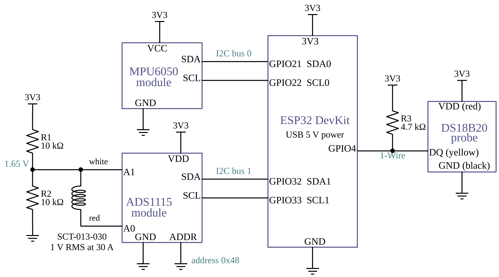

# Machine Black Box: firmware and live dashboard (v2.0)

A low-cost recorder that keeps what a machine was doing just before it failed, like an aircraft black box.
The ESP32 keeps a rolling record of the last 30 seconds of vibration, current and temperature.
When a trigger rule fires it freezes that record, records 10 seconds more, and sends the whole
40-second fault record to the dashboard, where you can see it as a timeline and download it.

College project for the MDC (Industry 4.0) course, Electronics and Communication Engineering, MIET Jammu.
Team: Pratyush Pangotra, Vansh Sharma, Tawishi Bajaj. Mentor: Dr. Himani Sharma.

**Status:** sensors wired on a zero PCB and reading; recorder firmware and dashboard written; full tests on a running machine are next.



```
firmware/mbb_main/mbb_main.ino                main firmware (flash this)
firmware/mbb_main/secrets.example.h           template for your WiFi settings (copy to secrets.h)
tools/mbb_sensor_check/mbb_sensor_check.ino   wiring check for the three sensors (115200 baud)
dashboard/index.html                          the dashboard (open in Chrome or Edge)
dashboard/app.js, lib/, fonts/                dashboard code, Chart.js, MQTT library, fonts (keep together)
broker/mosquitto.conf                         broker settings for the WiFi mode
docs/schematic.png                            circuit schematic of the board
licenses/                                     licences of the bundled libraries and fonts
```

---

## 1. Flash the ESP32

1. Arduino IDE, board **ESP32 Dev Module**. Libraries: **PubSubClient** (Nick O'Leary) and **OneWire** (Paul Stoffregen).
2. For WiFi: in `firmware/mbb_main/`, copy `secrets.example.h` to `secrets.h` and fill it in:
   - `MBB_WIFI_SSID`, `MBB_WIFI_PASSWORD`: your phone hotspot.
   - `MBB_MQTT_HOST`: the laptop's IP address on that hotspot.

   `secrets.h` is in `.gitignore`, so the password stays on your computer.
   Without `secrets.h` the firmware builds for the USB cable only.
3. Upload. Serial Monitor now runs at **460800 baud** (faster than the test sketch, so fault records go through quickly).
   You will see one JSON line every 100 ms, and lines starting with `#` for status messages.

Defaults on first start: vibration threshold 0.05 g, current and temperature triggers off, 1 clamp turn.
Changes made from the dashboard are kept in the ESP32's flash.

## 2. Open the dashboard

**USB cable (simplest)**
1. Close Arduino Serial Monitor (only one program can use the port).
2. In the `dashboard` folder run: `python -m http.server 8000`
3. Open **http://localhost:8000** in **Chrome or Edge**, choose **USB cable**, press **Connect**, pick the ESP32's port.

**WiFi (ESP32 on a power bank)**
1. Laptop and ESP32 on the same hotspot; `MBB_MQTT_HOST` in `secrets.h` set to the laptop's IP. Check the IP again on the day.
2. In the `broker` folder run: `mosquitto -c mosquitto.conf -v` (on Windows stop the Mosquitto service first: `net stop mosquitto`).
3. Windows Firewall: allow Mosquitto on private networks (ports 1883 and 9001).
4. Dashboard: choose **WiFi (MQTT)**, address `ws://localhost:9001`, **Connect**.

## 3. Using it

| Part | What it does |
|---|---|
| Tiles | Live vibration level (with a bar showing how close it is to the threshold), current, temperature, and the recorder state |
| Live charts | Last 60 s of each reading. Dashed line = trigger threshold. A vertical line marks each fault |
| Recorder | MONITORING (buffer filling up to 30 s), RECORDING (10 s after a fault), SAVED (record sent), CALIBRATING |
| Capture now | Makes a fault record on demand, with the same 30 s before and 10 s after |
| Calibrate baseline | Run it with the machine working normally. It measures vibration for 20 s and sets the threshold to the normal level plus 6 times its spread (at least 0.01 g above normal). You can still type your own value |
| Thresholds | Vibration (g), current (A) and temperature (°C). 0 turns the current or temperature trigger off. Clamp turns = how many times the wire loops through the clamp |
| Fault records | Click one to open its timeline: vibration, current and temperature from 30 s before to 10 s after, with a summary table. **Download CSV** gives the numbers for your report. The last 25 records are kept in this browser |
| Light / Dark | Switches the colour theme |

The same commands work in Serial Monitor (460800 baud, line ending "Newline"):
`capture`, `calibrate`, `set vib 0.05`, `set cur 2`, `set temp 60`, `turns 10`, `status`.

## 4. A two-minute review demo

1. Connect and show the live charts with the machine (or a fan) running normally.
2. Press **Calibrate baseline** and keep it running for 20 s; the threshold line moves to the new value.
3. Knock the sensor, or load the machine, so the vibration crosses the line. The recorder shows RECORDING,
   and 10 s later the fault record opens with the 30 s before the fault.
4. Press **Download CSV** to show the saved data.
5. Unplug the ESP32: the dashboard shows OFFLINE within a few seconds.

## 5. Troubleshooting

| Problem | Fix |
|---|---|
| A sensor shows "Not detected" | Flash `tools/mbb_sensor_check` (115200 baud) and follow its checklist, then flash the main firmware again |
| Serial Monitor shows garbage | Set it to 460800 baud |
| USB Connect fails | Close Serial Monitor; use Chrome or Edge; open the page from `http://localhost`, not by double-clicking |
| `MQTT: failed (state -2)` | Wrong `MBB_MQTT_HOST`, or the firewall is blocking port 1883 |
| Gaps in the charts every 15 s | WiFi is set but the broker is not running; each retry can pause sampling. For USB-only use set `MBB_WIFI_SSID` to `""` in `secrets.h`, or delete `secrets.h` |
| Clamp bias not about 1.65 V | R1's free end is not on 3.3 V, or the midpoint touches GND |
| Current reads about 0 with a load running | The clamp is around a whole cable (live and neutral cancel). Clamp one wire only |

## 6. Message format (for the report)

The ESP32 sends one JSON object per line on USB, and the same objects over MQTT:

| MQTT topic | Content |
|---|---|
| `mbb/mbb-01/status` | `online` / `offline` (retained; `offline` is sent by the broker if the ESP32 disappears) |
| `mbb/mbb-01/live` | every 100 ms: `{"type":"live","t":ms,"vib":g,"cur":A,"temp":C,"ax","ay","az","state","left","fill"}` |
| `mbb/mbb-01/health` | every 2 s: sensors detected, clamp bias voltage, thresholds, WiFi, uptime |
| `mbb/mbb-01/event` | each fault record: `{"type":"event","id","reason","rate_hz":10,"pre":300,"post":100,"thr","peak","vib":[...],"cur":[...],"temp":[...]}` (retained) |
| `mbb/mbb-01/msg` | trigger notices, calibration results, command replies |
| `mbb/mbb-01/cmd` | commands in (same words as in Serial Monitor) |

Sampling: MPU6050 at 100 readings/s, reduced to 10 vibration-level values/s (spread of |a| in each 100 ms);
ADS1115 at 860 samples/s on A0 − A1, giving RMS current over each 100 ms (5 mains cycles); DS18B20 once a second.

## Licence

The project code is under the MIT licence (see `LICENSE`).

Bundled third-party files keep their own licences, included in `licenses/`:
Chart.js 4.4.6 (MIT), MQTT.js 5.10.1 (MIT), IBM Plex Sans and Mono fonts (SIL Open Font Licence 1.1).
